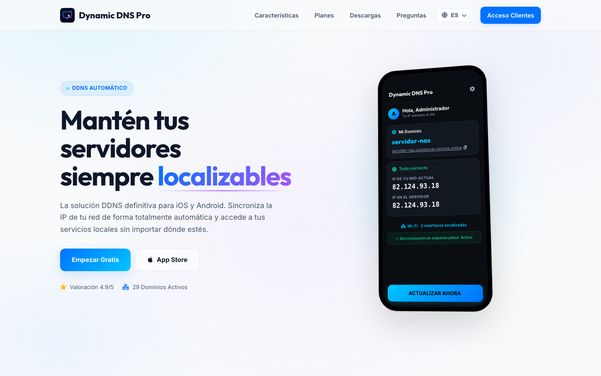

  

<h1 align="center">Dynamic DNS Pro</h1>

Mantieni i tuoi server sempre raggiungibili. DDNS automatico per iOS e Android — la tua IP sincronizzata in pochi secondi, più agenti Windows con audit e desktop remoto.

  
  
  
  

🌍 <a href="README.es.md">🇪🇸 Español</a> · <a href="README.md">🇬🇧 English</a> · <a href="README.de.md">🇩🇪 Deutsch</a> · <a href="README.fr.md">🇫🇷 Français</a> · <strong>🇮🇹 Italiano</strong> · <a href="README.pt.md">🇵🇹 Português</a>

> **Questo repository pubblica solo release binarie ufficiali** — il codice sorgente è privato. Download firmati, checksum e feed di aggiornamento automatico.

## Download

| | |
|---|---|
|  **App mobile** | iOS e Android — registrati gratis su [dynamicdnspro.com](https://dynamicdnspro.com) |
|  **Agent (Windows)** | [DynamicDNSPro-Agent-Setup.exe](https://github.com/mavksoft/dynamicdnspro-releases/releases/latest) — aggiornamento IP, audit del dispositivo e monitoraggio servizi |
|  **Remote (Windows)** | [DynamicDNSPro-Remote-Setup.exe](https://github.com/mavksoft/dynamicdnspro-releases/releases/latest) — desktop remoto WebRTC e trasferimento file sicuro |
|  **Sito ufficiale** | [dynamicdnspro.com](https://dynamicdnspro.com) — portale clienti, piani e FAQ |

## Che cos'è

Dynamic DNS Pro associa un nome facile da ricordare (tuo-server.dynamicdnspro.com) all'IP pubblico variabile della tua rete. L'app rileva ogni cambio di rete — da Wi-Fi a 4G/5G, da casa a ovunque — e aggiorna il record in pochi secondi. Niente script né IP scadute: raggiungi NAS, server o telecamera sempre con lo stesso nome.

## Funzionalità

- **Sincronizzazione istantanea** — l'app rileva i cambi di rete (Wi-Fi ↔ 4G/5G) e segnala la nuova IP in pochi secondi.
- **Rilevamento intelligente** — riconosce proxy, VPN e iCloud Private Relay affinché l'IP sul server sia sempre quella reale.
- **Selezione interfaccia** — forza manualmente quale interfaccia locale o tunnel VPN segnalare.
- **Agente Windows** — aggiornamento IP automatico, audit del dispositivo (hardware SMART incluso) e monitoraggio servizi.
- **Modulo Remote** — desktop remoto WebRTC e trasferimento file sicuro per l'assistenza.
- **Avvisi** — notifiche email/push quando l'IP cambia o qualcosa va fuori sync (secondo il piano).
- **Multi-dominio** — fino a 25 domini attivi per account secondo il piano.
- **Sei lingue** — sito e app in ES / EN / FR / IT / DE / PT.

## Come si usa

1. Registrati su dynamicdnspro.com (piano Free) e crea il tuo dominio — es. `mio-nas.dynamicdnspro.com`.
2. Installa l'app mobile e collega il dominio: l'IP si aggiorna da sola a ogni cambio di rete.
3. Sui PC Windows da tenere raggiungibili, installa l'Agent — mantiene l'IP aggiornata in background e fa l'audit della macchina.
4. Per l'assistenza remota, installa il modulo Remote: desktop WebRTC e trasferimento file dal pannello web.
5. Punta i tuoi servizi (VPN, NAS, telecamere) al nome DDNS — non dipendi più dall'IP numerica.

## Edizioni e prezzi

| Piano | Prezzo | Domini | Include |
|---|---|---|---|
| **Free** | 0 €/mese | 1 | Aggiornamento manuale + background, avvisi di cambio IP |
| **Basic** | 0,99 €/mese | 5 | Sync in background, avvisi email/push, multi-dominio |
| **Pro** | 1,99 €/mese | 15 | Avvisi prioritari, config. interfaccia, supporto 24/7 |
| **Elite** | 2,99 €/mese | 25 | Tutto Pro, per grandi infrastrutture |

## Requisiti

iOS e Android per l'app mobile · Windows per Agent e Remote · Ogni release include checksum `.sha256` di tutti i binari.

## Cosa contiene questo repository

- `DynamicDNSPro-Agent-Setup-<versione>.exe` — installer agente Windows (DDNS + audit + monitoraggio)
- `DynamicDNSPro-Remote-Setup-<versione>.exe` — installer modulo remoto (WebRTC + file)
- `ddnspro-bin-<versione>.zip` — binari completi impacchettati
- `ddns_engine.exe`, `agente_v3.exe`, `supervisor.exe`, `smartctl.exe` — componenti singoli
- `*.sha256` — checksum di ogni binario
- `version.json`, `fleet.json` — feed di versione e flotta per l'auto-update

[Ultima release](https://github.com/mavksoft/dynamicdnspro-releases/releases/latest)

## Domande frequenti

**Cos'è un DNS dinamico?**  
Associa un nome fisso (tuo-nome.dynamicdnspro.com) a un'IP che cambia. Quando il provider cambia l'indirizzo, il nome risolve sempre correttamente.

**Posso segnalare l'IP di un'interfaccia VPN?**  
Sì — dal piano Basic puoi scegliere esplicitamente quale interfaccia o tunnel VPN segnalare.

**Perché due installer Windows?**  
Agent mantiene il DNS aggiornato e fa l'audit della macchina; Remote aggiunge desktop remoto WebRTC e trasferimento file. Installa solo ciò che serve.

## Assistenza

- Sito e portale clienti: [dynamicdnspro.com](https://dynamicdnspro.com)
- FAQ: [dynamicdnspro.com#faq](https://dynamicdnspro.com/#faq)

---

Dynamic DNS Pro · © MavkSoft / IT-Systems

